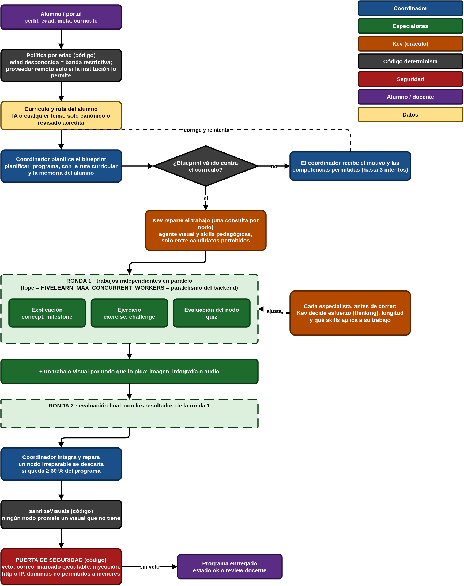
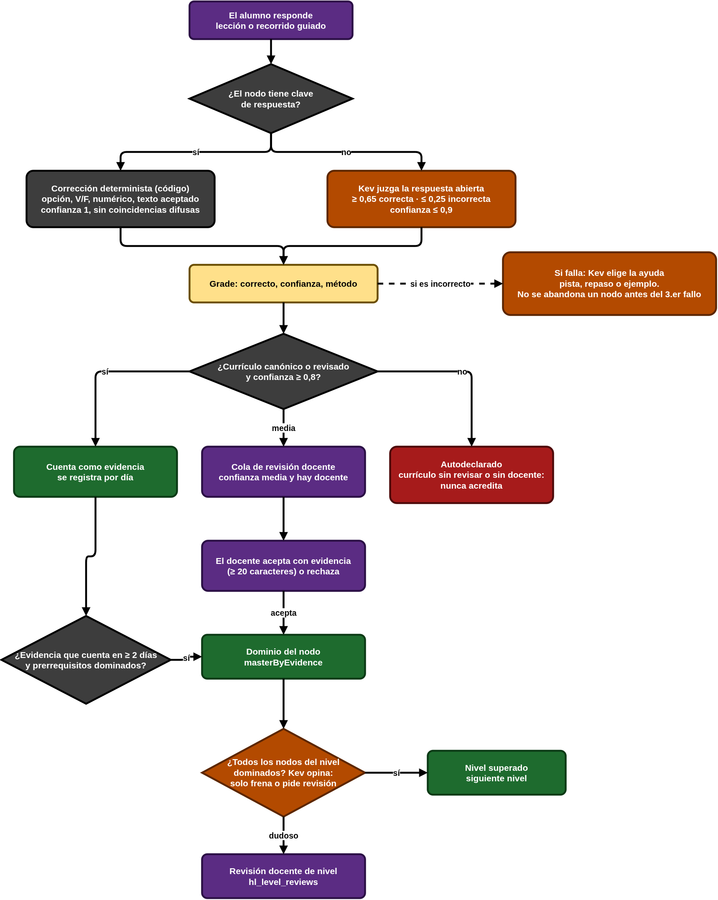
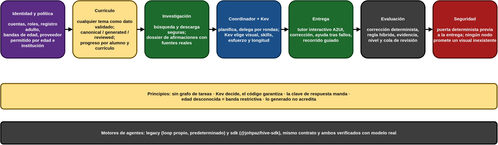
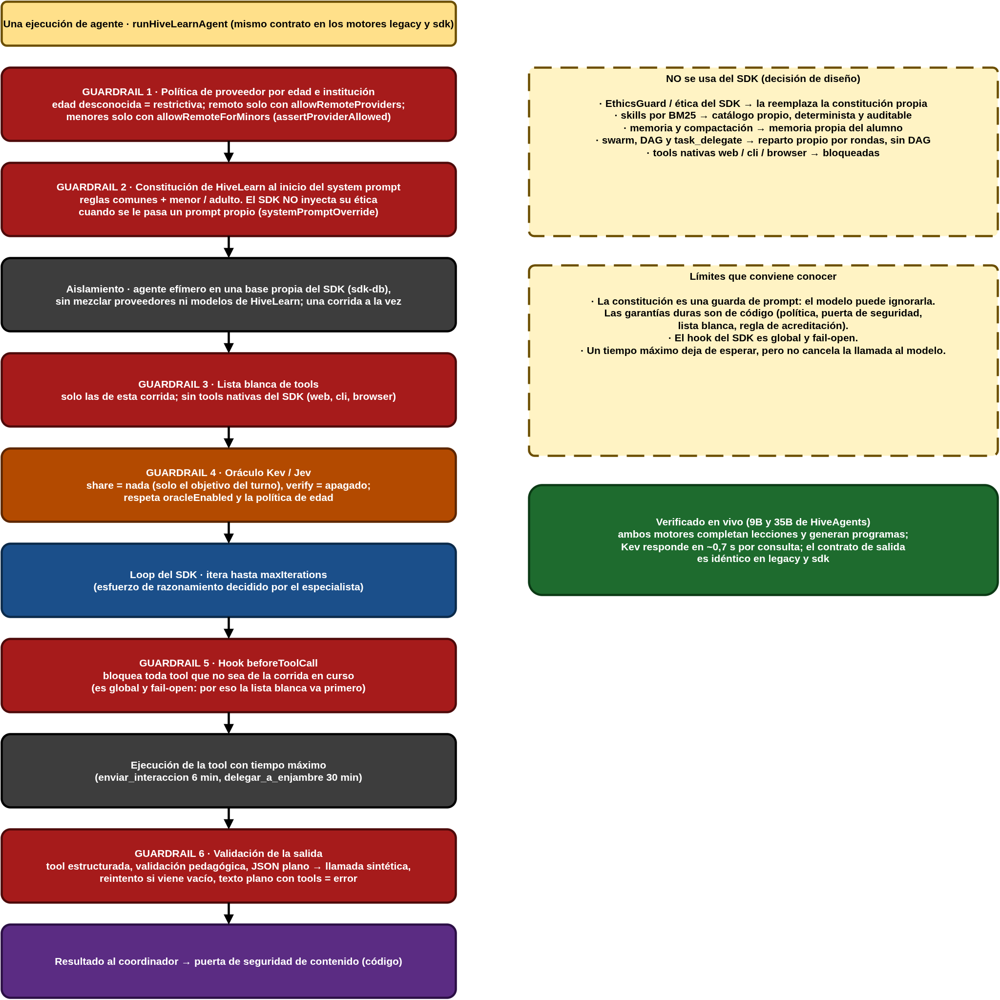

# Arquitectura del núcleo de HiveLearn

Documento de referencia del "cerebro". La interfaz consume estas piezas; no las reimplementa.

## Diagramas
Editables con draw.io: [`diagramas/proceso-hivelearn.drawio`](diagramas/proceso-hivelearn.drawio) (4 páginas).

1. 
2. 
3. 
4. 

## Principios
- **Sin grafo de tareas.** Un coordinador reparte el trabajo a especialistas por rondas; no hay dependencias declaradas.
- **Kev decide, el código garantiza.** El oráculo de decisiones (HiveAgents Kev, o Jev) elige y juzga; toda decisión tiene un respaldo determinista y límites fijados por código.
- **La clave de respuesta manda.** Con respuesta conocida corrige el código; el oráculo solo juzga respuestas abiertas.
- **Edad desconocida = banda más restrictiva.** La política por edad se aplica en cada llamada a un modelo.
- **Lo generado no acredita.** Solo currículos `canonical` o `reviewed` acreditan; el resto es progreso autodeclarado.

## Capas
| Capa | Dónde | Qué hace |
|---|---|---|
| Identidad y política | `institutional/accounts.ts`, `institutional/age.ts`, `agent/policy/` | Cuentas, roles, registro adulto, bandas de edad, proveedores permitidos por edad e institución |
| Currículo | `institutional/curriculum-def.ts`, `curriculum-store.ts`, `curriculum-progress.ts` | Cualquier tema como dato validado; estados `canonical/generated/reviewed`; progreso por (alumno, currículo) |
| Investigación | `research/`, `agent/researcher.ts` | Búsqueda y descarga seguras; dossier de afirmaciones con fuentes reales |
| Autoría | `agent/curriculum-architect.ts`, `agent/swarm/` | Genera currículos y programas; puerta de seguridad determinista |
| Reparto del trabajo | `agent/swarm/jobs.ts`, `work-plan.ts`, `coordinator-delegation.ts`, `agent/executor.ts` | Rondas de trabajos por especialista, con Kev decidiendo visual, skills, esfuerzo y longitud |
| Entrega | `lesson/LessonDeliverySession.ts`, `tools/coordinator/` | Tutor interactivo A2UI, corrección, ayuda tras fallos, memoria |
| Evaluación | `grading/` | Corrección determinista, rúbrica, regla híbrida de acreditación, evidencia |
| Oráculo | `agent/kev/` | Cliente, juicio de respuestas y de nivel, delegación, ayuda del tutor |
| Memoria | `storage/student-memory.ts` | Dominio por nodo, repaso espaciado, errores recurrentes; brief anónimo para el tutor |
| Portal | `institutional/portal.ts` | HTTP: cuentas, currículos, diagnóstico, recorrido guiado, cola de revisión |

## Flujo de generación de un programa
1. El coordinador planifica el blueprint (`planificar_programa`) sobre la ruta curricular del alumno. Si el modelo se sale del currículo se le devuelve el motivo (hasta 3 intentos).
2. `prepareDelegation`: Kev propone por nodo visual y skills (una consulta por nodo, sin identidad del alumno).
3. Ronda 1: un trabajo pedagógico por nodo y, si el nodo lo pide, uno visual. Ronda 2: evaluación final con los resultados de la ronda 1.
4. Cada especialista afina su corrida (esfuerzo → `thinking`, longitud, skills).
5. El coordinador integra, repara (un nodo irreparable se descarta si queda ≥ 60 %) y revisa.
6. `sanitizeVisuals` y la puerta de seguridad (`safety/content-safety.ts`) deciden si se entrega.

## Acreditación
```
respuesta ─ con clave ──► corrección determinista (confianza 1)
          └ abierta ────► Kev (≥0,65 correcta, ≤0,25 incorrecta) → confianza ≤ 0,9
confianza ≥ 0,8 + currículo que acredita  ► cuenta como evidencia
confianza media / hay docente             ► cola de revisión docente
currículo generado                        ► autodeclarado (nunca acredita)
dominio ► evidencia que cuenta en ≥ 2 días distintos + prerrequisitos dominados
nivel   ► todos los nodos dominados; Kev solo frena o pide revisión
```

## Seguridad de la investigación web
Solo https (443), sin credenciales, IP privadas bloqueadas (incluidas notaciones alternativas e IPv6), DNS validado y redirecciones revalidadas en cada salto, tope de tiempo y bytes, solo contenido textual, dominios por banda de edad. Límite conocido: DNS rebinding entre comprobación y conexión.

## Guardrails de una ejecución
En orden, para cada llamada a un agente (`runHiveLearnAgent`, ambos motores):
1. **Política de proveedor** por edad e institución (`assertProviderAllowed`).
2. **Constitución de HiveLearn** al inicio del prompt (`agent/policy/constitution.ts`). El SDK arma su propia sección ética solo cuando usa su `buildSystemPrompt`; con `systemPromptOverride` no la incluye, así que sin esta capa las ejecuciones no llevaban reglas éticas explícitas.
3. **Lista blanca de tools** de la corrida; sin tools nativas del SDK.
4. **Oráculo** sin compartir nada del turno salvo el objetivo.
5. **Hook `beforeToolCall`** que bloquea toda tool ajena a la corrida (global y fail-open).
6. **Validación de la salida** (tool estructurada, validación pedagógica, reintento ante vacío).

La constitución es una guarda de prompt, no una garantía: las garantías duras son de código (política, puerta de seguridad, lista blanca, regla de acreditación).

## Motores de agentes
`legacy` (loop propio, predeterminado) y `sdk` (`@johpaz/hive-sdk`, `HIVELEARN_AGENT_ENGINE=sdk`). Contrato idéntico (`agent/runner.contract.test.ts`); ambos verificados con modelo real.
